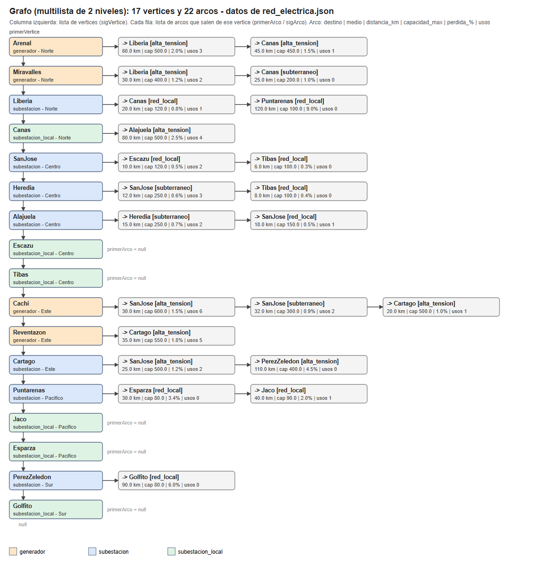
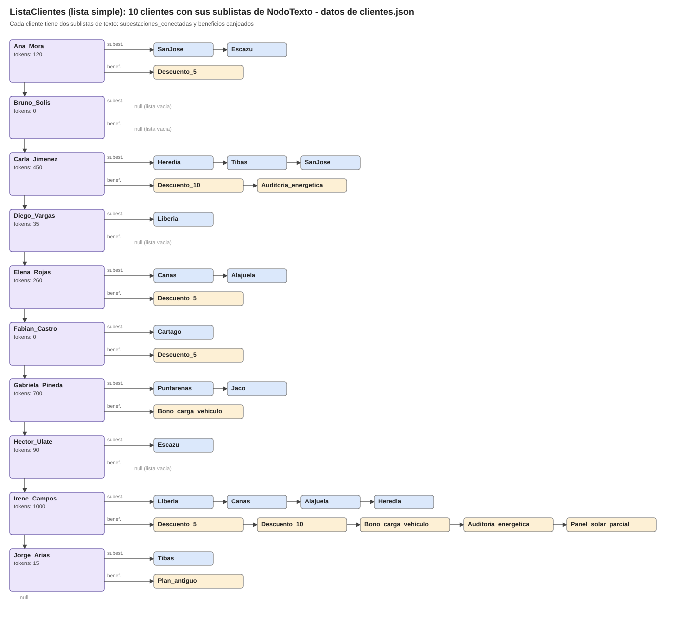
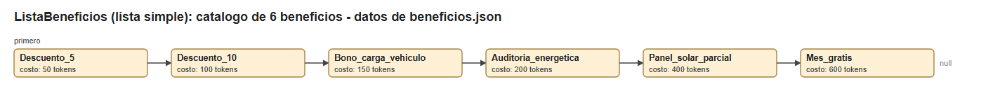

<!--
  Borrador de la documentación (Persona 2).
  Las marcas [COMPLETAR] y [CAPTURA] se llenan cuando el programa de Persona 1 esté integrado (lun 23).
  Para entregarlo como PDF: abrir en VS Code o Typora y exportar, o pegar en Word con las imágenes de docs/img/.
-->

# Portada

**[COMPLETAR: nombre de la institución]**
**Escuela de [COMPLETAR]**

**IC2001 Estructuras de Datos**
**Segundo Proyecto**

## Sistema de Optimización y Distribución para una Red Eléctrica Inteligente (Smart Grid)

| | |
|---|---|
| Profesora | [COMPLETAR] |
| Integrantes | [COMPLETAR: nombre y carné] · [COMPLETAR: nombre y carné] |
| Grupo | [COMPLETAR] |
| Fecha de entrega | 24 de noviembre de 2026 |

---

## Índice
1. Introducción
2. Diseño de las estructuras de datos
3. Diagrama de estructuras con los datos reales
4. Archivos JSON: formato, carga y guardado
5. Manual de uso
6. Análisis de resultados
7. Conclusiones
8. Recomendaciones
9. Anexo A: decisiones de diseño
10. Anexo B: registro de fuentes y de uso de IA

---

## 1. Introducción

El programa modela la red eléctrica de una distribuidora como un **grafo dirigido**. Los vértices son los puntos de interconexión (generadores, subestaciones y subestaciones locales) y los arcos son las líneas de transmisión. Sobre ese grafo se hacen recorridos (BFS y DFS), búsqueda de rutas filtradas por medio de transmisión, la ruta de menor pérdida con Dijkstra y la ruta que más Eco-Tokens otorga a un cliente. Los tokens se canjean por beneficios de un catálogo.

Los datos se cargan al iniciar desde tres archivos JSON (`red_electrica.json`, `clientes.json` y `beneficios.json`). Se guardan al salir y cuando el usuario lo pide desde el menú.

Todo está escrito en C++17. Las listas son propias y usan punteros. La única biblioteca externa es nlohmann/json, que se usa solo para leer y escribir los archivos.

## 2. Diseño de las estructuras de datos

| Clase | Estructura | Contenido |
|---|---|---|
| `Grafo` | Multilista de 2 niveles | Lista simple de `Vertice`; cada vértice tiene su lista simple de `Arco` |
| `Vertice` | Nodo de lista | nombre, tipo, región (texto), marca `visitado`, `sigVertice`, `primerArco` |
| `Arco` | Nodo de lista | puntero al vértice destino, medio, distancia_km, capacidad_max, pérdida %, usos, `sigArco` |
| `ListaClientes` | Lista simple | `Cliente`: nombre, tokens y dos sublistas de `NodoTexto` (subestaciones conectadas y beneficios canjeados) |
| `ListaBeneficios` | Lista simple | `Beneficio`: nombre y costo; se imprime con recursión (B3) |
| Cola del BFS | [COMPLETAR: cola propia o `std::queue`] | Se usa en el BFS |
| `ArchivoJSON` | — | Lee y escribe los 3 archivos usando solo los métodos públicos de las otras clases |
| `Menu` | — | Submenús de CRUD, Reportes y Consultas |

**¿Por qué una multilista?** Así cada vértice tiene acceso directo a sus arcos de salida, y se puede insertar o borrar sin saber de antemano cuántos nodos tendrá la red. La región se guarda como texto en el vértice. Por eso la red completa se recorre con una sola lista, y al guardar los vértices se reagrupan por región.

**¿Por qué guardar las subestaciones de un cliente como texto y no como punteros?** Si se borra un vértice, ningún cliente queda con un puntero colgante. El borrado lo quita de las listas de todos los clientes, y si se renombra, el cambio también se aplica en esas listas.

## 3. Diagrama de estructuras con los datos reales

Los diagramas se generaron directamente a partir de los archivos de `data/`, así que coinciden exactamente con lo que el programa carga.

### 3.1 Grafo (17 vértices y 22 arcos)


### 3.2 Lista de clientes con sus sublistas


### 3.3 Catálogo de beneficios


## 4. Archivos JSON: formato, carga y guardado

El formato completo, con ejemplos de cada archivo, está en `docs/datos_y_casos_de_prueba.md` (sección 1). En resumen:

Los archivos siguen el formato del enunciado:

- **red_electrica.json**: `regiones` (cada una con `nombre` y su lista de `puntos_interconexion`) y `lineas_transmision`. El origen y el destino de cada línea son objetos con `region` y `punto`. Cada línea tiene además medio, distancia_km y perdida_porcentaje, y se agregaron `capacidad_max` (la pide el enunciado como atributo del arco) y `usos` (para la ruta frecuente / única). Si una línea no trae estos dos campos se usan 100 y 0.
- **clientes.json**: `clientes`, cada uno con nombre, tokens, subestaciones_conectadas y beneficios.
- **beneficios.json**: `beneficios`, cada uno con nombre y costo.

**Carga.** Se lee primero la red (todos los vértices y después todos los arcos, para que los arcos encuentren a sus vértices), luego los beneficios y por último los clientes, porque sus subestaciones se validan contra la red.

| Situación | Qué hace el programa |
|---|---|
| Falta `red_electrica.json` o tiene un error de sintaxis | Muestra el error y termina |
| Falta `clientes.json` o `beneficios.json` | Avisa y arranca con esa lista vacía |
| `clientes.json` o `beneficios.json` tienen un error de sintaxis, o les falta un campo | Muestra el error con el elemento que falló y termina |
| Valor inválido en un archivo bien formado (pérdida 150, nombre repetido, lazo…) | Se omite ese dato con un aviso y la carga continúa |
| Un cliente tiene una subestación que no existe | Se ignora esa subestación con un aviso |
| Una línea no trae `capacidad_max` o `usos` | Se usan 100 y 0, con un aviso por la capacidad |

Cuando el programa termina por un error de carga, no modifica ningún archivo. Así nunca se sobrescriben los datos con listas vacías por accidente.

**Guardado.** Se hace al salir y cuando el usuario lo pide. Los vértices se reagrupan por región, y usos, tokens y costos se escriben como enteros. Cada archivo se escribe primero en un temporal `.tmp` y después reemplaza al original, para que un fallo a medias no deje un archivo dañado.

## 5. Manual de uso

> [COMPLETAR cuando el menú esté terminado: confirmar los números de cada opción y agregar las capturas.]

### 5.1 Compilar y ejecutar
Desde la carpeta raíz del proyecto (ahí está la carpeta `data/`):
```
g++ -std=c++17 src/*.cpp -o smartgrid
./smartgrid          (en Windows: smartgrid.exe)
```
Si se usa un IDE, el *working directory* tiene que ser la carpeta raíz.

[CAPTURA: mensajes de carga al iniciar]

### 5.2 Uso general
- Las opciones se eligen escribiendo su número. Si se escribe algo que no es un número o está fuera de rango, el programa lo vuelve a pedir.
- Los vértices, clientes y beneficios también se eligen de una lista numerada, así no hay que escribir los nombres.
- Los nombres se escriben sin tildes. La comparación es exacta: `SanJose` y `sanjose` son nombres distintos.

### 5.3 Menú principal
| Opción | Qué hace |
|---|---|
| CRUD | Agregar, modificar y eliminar vértices, arcos, clientes y beneficios; asignar tokens a mano |
| Reportes | BFS, DFS, lista de beneficios, reporte de clientes y nodos inactivos |
| Consultas | Todas las rutas por medio, ruta de menor pérdida, ruta de mayor Eco-Tokens, canje y ruta frecuente/única |
| Guardar | Escribe los 3 archivos JSON en ese momento |
| Salir | Guarda y cierra |

[CAPTURA: menú principal]

### 5.4 CRUD
- **Vértices:** nombre, tipo (generador, subestacion o subestacion_local) y región. Al eliminar un vértice se borran sus líneas de entrada y de salida, y se quita de las listas de todos los clientes. Al renombrarlo, el nombre nuevo también se actualiza en esas listas.
- **Arcos:** origen, destino, medio, distancia (> 0), capacidad (> 0) y pérdida (de 0 a 100). Puede haber dos líneas entre el mismo par de nodos solo si usan medios distintos; por eso, para eliminar una se piden origen, destino y medio.
- **Clientes:** nombre y tokens (≥ 0). Al asignar tokens a mano se puede restar, pero el saldo nunca queda negativo.
- **Beneficios:** nombre y costo. Si se borra un beneficio del catálogo, los clientes que ya lo canjearon lo conservan.

[CAPTURA: agregar un vértice] [CAPTURA: eliminar un vértice con cascada]

### 5.5 Reportes
- **BFS / DFS:** se elige el nodo de inicio. Se muestra el orden de visita, el árbol de recorrido (quién descubrió a quién) y al final los nodos que no se alcanzan.
- **Beneficios:** el catálogo completo, impreso con una función recursiva.
- **Clientes:** tokens, subestaciones y beneficios de cada cliente. No aparecen los clientes sin historial.
- **Nodos inactivos:** subestaciones que no aparecen en la lista de ningún cliente.

[CAPTURA: BFS] [CAPTURA: DFS] [CAPTURA: reporte de clientes]

### 5.6 Consultas
- **Todas las rutas:** se eligen origen, destino y 1 o 2 medios. Se muestran todos los caminos simples cuyas líneas usan solo esos medios.
- **Ruta de menor pérdida:** Dijkstra sobre la suma de las pérdidas. Muestra la pérdida de cada línea.
- **Ruta de mayor Eco-Tokens:** se elige el cliente, el origen y el destino, y se indica si es hora no pico. Se muestra la mejor ruta y los tokens que da. Si el cliente acepta, recibe los tokens, se le agregan las subestaciones de la ruta y cada línea suma un uso.
- **Canje:** solo se muestran los beneficios que el cliente puede pagar y que no ha canjeado.
- **Ruta frecuente / única:** las líneas con más usos (si hay empate, se muestran todas) y las que se usaron una sola vez.

[CAPTURA: una captura por consulta]

## 6. Análisis de resultados

Cada requisito se probó con los datos de `data/`. Los resultados esperados se calcularon a mano y se verificaron con un script independiente antes de ejecutar el programa. El detalle completo está en `docs/datos_y_casos_de_prueba.md`.

> Columna **Obtenido**: [COMPLETAR] con ✔ si coincide, o con la descripción del fallo y su corrección.

| Req. | Prueba | Resultado esperado | Obtenido |
|---|---|---|---|
| Carga | Iniciar con los datos de `data/` | 17 nodos, 22 líneas, 6 beneficios, 10 clientes, sin avisos | |
| Carga | `data/pruebas/red_mal_formada.json` | Error de sintaxis y el programa termina | |
| Carga | `data/pruebas/red_datos_invalidos.json` | Carga 2 nodos y 1 línea; 3 nodos y 7 líneas rechazados, cada uno con su motivo | |
| Carga | `data/pruebas/clientes_subestacion_inexistente.json` | Aviso por Monteverde; rechaza el cliente repetido y los tokens negativos | |
| Carga | `data/pruebas/clientes_formato_incorrecto.json` | Error en "el cliente 1" y el programa termina | |
| Guardado | Cargar, salir sin cambios y comparar los archivos | Mismos datos que al inicio | |
| A1 | Eliminar Heredia | Desaparecen Alajuela→Heredia, Heredia→SanJose y Heredia→Tibas; Carla_Jimenez e Irene_Campos ya no lo tienen | |
| A1 | Eliminar Cachi→SanJose subterraneo | Se conserva Cachi→SanJose alta_tension | |
| A1 | Insertar Arenal→Liberia alta_tension | Rechazado: ya existe con ese medio | |
| A2 | Asignar −200 tokens a Ana_Mora (120) | Rechazado: el saldo quedaría negativo | |
| B1 | BFS desde Arenal | Arenal, Liberia, Canas, Puntarenas, Alajuela, Esparza, Jaco, Heredia, SanJose, Tibas, Escazu. No alcanzables: Miravalles, Cachi, Reventazon, Cartago, PerezZeledon, Golfito | |
| B2 | DFS desde Arenal | Arenal, Liberia, Canas, Alajuela, Heredia, SanJose, Escazu, Tibas, Puntarenas, Esparza, Jaco | |
| B3 | Imprimir beneficios | Los 6 del catálogo en orden | |
| B4 | Reporte de clientes | 9 clientes; Bruno_Solis no aparece | |
| B5 | Nodos inactivos | Esparza, PerezZeledon, Golfito | |
| C1 | Cachi→SanJose, solo alta_tension | 2 rutas | |
| C1 | Canas→SanJose, solo alta_tension | Mensaje de que no hay rutas | |
| C2 | Alajuela→SanJose | Directa red_local, pérdida 0,5 % | |
| C2 | Arenal→SanJose | Arenal→Canas→Alajuela→SanJose, 4,5 % | |
| C3 | Alajuela→SanJose, hora normal | Por Heredia, 13 tokens (Dijkstra eligió otra ruta) | |
| C3 | Arenal→SanJose, hora no pico | Por Liberia, Canas, Alajuela y Heredia, 38 tokens | |
| C3 | Liberia→Puntarenas | «no otorga tokens» (total −10) | |
| C3 | Puntarenas→Esparza | «no otorga tokens» (0,10 redondea a 0) | |
| C3 | Elena_Rojas acepta Arenal→SanJose, hora normal | Tokens 260→285; se agregan Liberia, Heredia y SanJose; cada línea de la ruta suma 1 uso | |
| C4 | Canje de Ana_Mora (120) | Solo se ofrece Descuento_10 | |
| C4 | Canje de Diego_Vargas (35) | No hay beneficios disponibles | |
| C5 | Con los datos iniciales | Frecuente: Cachi→SanJose alta_tension (6). Únicas: 5 líneas | |
| C5 | Después de aceptar Reventazon→SanJose en C3 | Empate en 6: Cachi→SanJose y Reventazon→Cartago | |

**Comparación entre C2 y C3.** En Alajuela→SanJose, Dijkstra elige la línea directa de red local porque pierde solo 0,5 %. Eco-Tokens prefiere pasar por Heredia (13,35 puntos contra 3,60): las dos líneas subterráneas suman más puntos aunque se pierda más energía. Los dos criterios responden preguntas distintas. Uno busca no desperdiciar energía y el otro premia usar más tramos y medios de mejor calidad.

[COMPLETAR: comentar cualquier diferencia que aparezca al ejecutar.]

## 7. Conclusiones

> Borrador. [COMPLETAR] Revisar y ajustar después de las pruebas reales.

- La multilista de dos niveles representa bien una red dirigida con un número variable de nodos. Cada vértice llega directo a sus líneas de salida, y la región funciona como un simple atributo de texto.
- Guardar como texto las subestaciones y los beneficios de cada cliente evitó punteros colgantes al borrar o renombrar vértices y beneficios. A cambio, cada actualización tiene que recorrer la lista de clientes.
- Separar el proyecto con un contrato de interfaz (los `.h`) permitió trabajar en paralelo: la lógica nunca depende de la biblioteca JSON y la carga nunca manipula punteros.
- Los casos de prueba diseñados a mano antes de programar sirvieron para probar todo: cada acuerdo tiene un caso en los datos con su resultado conocido.
- Dijkstra (menor pérdida) y la búsqueda exhaustiva de Eco-Tokens pueden elegir rutas distintas. La función objetivo determina la respuesta.

## 8. Recomendaciones

- Enumerar todas las rutas simples (C1 y C3) crece de forma exponencial con el tamaño de la red. Para redes grandes conviene acotar la búsqueda o usar un algoritmo con poda.
- Validar los JSON contra un esquema antes de cargarlos daría mensajes de error más claros.
- Guardar también la fecha de cada ruta aceptada permitiría reportes de uso por período.
- Definir desde el inicio la convención de nombres (sin tildes, comparación exacta) y comunicarla en el manual evita errores al escribir en la consola.
- [COMPLETAR con lo que se aprenda en la integración.]

## 9. Anexo A: decisiones de diseño

Estos acuerdos se tomaron antes de programar. Los marcados con (*) dependían de la respuesta de la profesora: [COMPLETAR con su respuesta].

**El grafo**
- Cada punto de interconexión es un vértice y la región es un atributo de texto. Al guardar se reagrupa por región.
- El nombre de un vértice es único en toda la red y se compara de forma exacta.
- El grafo es estrictamente dirigido.
- (*) Cada línea tiene capacidad_max. Solo se usa distancia_km. La pérdida es un dato propio de cada línea.
- Los medios forman un conjunto cerrado: alta_tension, subterraneo y red_local.
- Al borrar un vértice se borran sus arcos de entrada y salida, y se quita de las listas de los clientes. Renombrar un vértice actualiza a los clientes. Para borrar un arco se piden origen, destino y medio.

**Las consultas**
- Dijkstra minimiza la suma de las pérdidas porcentuales.
- Todas las rutas son caminos simples que usan 1 o 2 medios, y el filtro se aplica durante la búsqueda.
- Puntaje por arco = tabla[medio] − pérdida − 0,05 × distancia (10 / 8 / 5). En hora no pico, un total positivo se multiplica por 1,5. Después se redondea, y si el resultado es ≤ 0 la ruta no otorga tokens. Si el cliente acepta, se le suman los tokens, se agregan las subestaciones de la ruta sin repetir y cada línea suma un uso.
- (*) Una "ruta" para C5 es una línea. Solo cuentan las rutas aceptadas en C3. Si hay empate, se muestran todas. Los usos vienen precargados en el JSON.
- Un nodo inactivo es una subestación (de cualquier tipo) que no está en la lista de ningún cliente. Los generadores no cuentan.

**Clientes y beneficios**
- (*) El catálogo está en beneficios.json, con nombre y costo entero. Los clientes guardan textos, no punteros.
- Cada beneficio se canjea una sola vez por cliente. Solo se muestran los que el cliente puede pagar. Si se borra del catálogo, el cliente lo conserva.
- Un cliente sin historial (0 tokens y listas vacías) no sale en el reporte. Los tokens asignados a mano nunca dejan el saldo negativo.
- Una subestación inexistente en clientes.json se ignora con un aviso.
- Formato: los JSON siguen el formato del enunciado; `capacidad_max` y `usos` son opcionales (100 y 0 por defecto).

**Aspectos técnicos**
- (*) Nlohmann/json y std::string. Las listas son propias. La cola del BFS: [COMPLETAR: propia o std::queue]. DFS y backtracking son recursivos.
- Se guarda al salir y bajo demanda. Las reglas de carga están en la sección 4.
- BFS y DFS imprimen el árbol de recorrido y los nodos no alcanzables. Los vecinos se visitan en orden de inserción.
- Validaciones de nombres, duplicados, lazos, rangos numéricos, tipos y medios, y lectura segura de números.
- Menú con submenús y selección por lista numerada. Un `.h` y un `.cpp` por clase.
- Rechazo de datos: los métodos de inserción imprimen el motivo y devuelven `false`, y la carga continúa con el siguiente dato.

## 10. Anexo B: registro de fuentes y de uso de IA

### Fuentes
| Fuente | Uso |
|---|---|
| nlohmann/json v3.11.3, https://github.com/nlohmann/json (licencia MIT) | Lectura y escritura de JSON (`src/json.hpp`) |
| Documentación de nlohmann/json, https://json.nlohmann.me | `parse`, `contains`, `is_number_integer`, `dump` |
| Material del curso IC2001 | Listas enlazadas, grafos, BFS, DFS y Dijkstra |
| [COMPLETAR] | |

### Uso de IA
| Fecha | Herramienta | Quién | Prompt (resumen o textual) | Qué se usó de la respuesta |
|---|---|---|---|---|
| 16/11/2026 | Claude (Claude Code) | Persona 2 | Se adjuntó el PDF de división del trabajo y el enlace al repositorio: "lee toda la información del github del repo para que a la hora de trabajar en mi parte todo se complemente" | Resumen del estado del repo y del contrato de interfaz |
| 16/11/2026 | Claude (Claude Code) | Persona 2 | "soy persona 2" (hacer la parte de datos) | Implementación de `ArchivoJSON` (carga y guardado), los 3 JSON de prueba, los archivos de `data/pruebas/` y `docs/datos_y_casos_de_prueba.md`. Los resultados esperados se verificaron con un script |
| 16/11/2026 | Claude (Claude Code) | Persona 2 | "necesito que hagas todo lo que a mí me toca" | Diagramas de estructuras generados desde los JSON y este borrador de documentación |
| 20/11/2026 | Claude | Persona 1 | "podrías arreglar los detalles de la versión de mi compañero" | Ajuste del formato de los JSON al del enunciado (`puntos_interconexion`, origen y destino con región y punto, `beneficios` en clientes), `capacidad_max` y `usos` opcionales, archivo de prueba con el formato exacto del enunciado y esta documentación sin códigos de decisión |
| [COMPLETAR] | | | | |

**Revisión humana.** [COMPLETAR: qué se revisó, se probó o se cambió de lo generado.]
